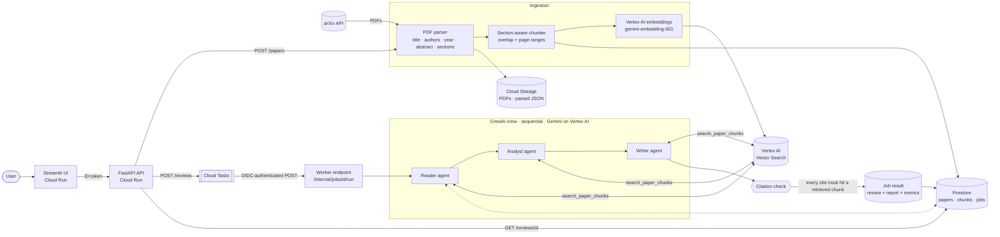

# Research Crew

A [CrewAI](https://docs.crewai.com) application that reads academic papers and drafts a structured
literature review in Markdown, with every claim cited as `[paper_id, page]`.

* **Reasoning:** Gemini on Vertex AI (CrewAI's native Google provider)
* **Retrieval:** Vertex AI Vector Search over `gemini-embedding-001` embeddings
* **Papers:** upload PDFs, or let the system fetch them from the arXiv API
* **Serving:** FastAPI + Cloud Tasks workers + Streamlit UI on Cloud Run, provisioned with Terraform

The question goes in; a review comes out whose citations have been **machine-checked against the
text chunks the agents actually retrieved**. Unsupported claims are dropped before you see them.

## Architecture



### The agents

| Step | Agent | Tools | Pydantic output |
|---|---|---|---|
| 1 | **Reader** — retrieves chunks per paper, summarises problem / method / dataset / results / limitations | `search_paper_chunks`, `read_paper_structure`, `search_arxiv` | `ReaderOutput` |
| 2 | **Analyst** — key findings, comparison table, agreements, contradictions, gaps | `search_paper_chunks` | `AnalysisOutput` |
| 3 | **Writer** — intro, themes, comparison table, gaps, future directions; cites every claim | `search_paper_chunks` | `LiteratureReview` |
| 4 | **Citation check** (plain code, not an LLM) | retrieval log | `CitationReport` |

Each agent has its own LLM instance (CrewAI sums usage per agent, so sharing one would triple-count
tokens). The reference list is rendered from stored metadata, so the model cannot invent papers.

### The citation check

`research_crew/citations.py` parses every `[paper_id, page]` (also `[id, p. 3]`, `[id, 3-4]`,
`[a, 2; b, 5]`) and accepts it only if the paper belongs to the job **and** some chunk of that paper
covering that page was returned by retrieval during the job. Per claim (sentence, bullet, table row):

* all citations valid → kept
* some invalid → the invalid ones are removed
* all invalid → the claim is **dropped** (or marked, with `on_unsupported="flag"`)
* no citation, but it reads like a factual claim in *Themes* → kept and marked `⚠️[uncited]`

The report returns the writer's raw citation accuracy (before cleanup), what was dropped, and what was flagged.

## Quick start (local, no GCP resources)

Requires Python 3.10–3.13 (CrewAI does not support 3.14 yet).

```bash
python3.12 -m venv .venv && source .venv/bin/activate
pip install -e ".[dev,frontend]"
pytest                      # 107 tests, fully offline

cp .env.example .env        # defaults: local disk + in-process vector search + hashing embedder
```

The agents still need Gemini. Either use Vertex AI with Application Default Credentials
(`gcloud auth application-default login`, then set `GOOGLE_CLOUD_PROJECT` and
`GOOGLE_GENAI_USE_VERTEXAI=true` in `.env`) or a Gemini API key (`GEMINI_API_KEY=...`).

```bash
uvicorn research_crew.api:create_app --factory --port 8000       # API
API_URL=http://localhost:8000 streamlit run frontend/app.py      # UI
```

```bash
# upload, start, poll, fetch
curl -F files=@paper1.pdf -F files=@paper2.pdf localhost:8000/papers
curl -X POST localhost:8000/reviews -H 'content-type: application/json' \
     -d '{"question": "What methods reduce hallucination in RAG systems?", "use_arxiv": true, "max_papers": 6}'
curl localhost:8000/reviews/<job_id>
curl "localhost:8000/reviews/<job_id>/result?format=markdown"
```

| Endpoint | Purpose |
|---|---|
| `POST /papers` | upload PDFs (multipart) → parse, chunk, embed, index |
| `GET /papers` | list ingested papers |
| `POST /reviews` | start a job (`question`, `paper_ids`, `use_arxiv`, `max_papers`) → `202` + `job_id` |
| `GET /reviews/{id}` | status, stage (`ingest` → `crew` → `verify`), tokens / latency / cost |
| `GET /reviews/{id}/result` | review + citation report (`?format=markdown` for raw Markdown) |
| `POST /internal/jobs/{id}/run` | worker entrypoint called by Cloud Tasks |

With `job_backend=local` jobs run on a small in-process thread pool; with `gcp` they go through Cloud
Tasks. A job only starts if it is still `queued`, so Cloud Tasks re-deliveries are harmless.

## Deploy to Google Cloud

```bash
# 1. infrastructure: Vector Search index + endpoint, bucket, Firestore, Cloud Tasks queue,
#    Artifact Registry, service accounts and IAM
cd infra/terraform
cp terraform.tfvars.example terraform.tfvars    # set project_id
terraform init && terraform apply

# 2. build with Cloud Build and deploy API + frontend to Cloud Run
cd ../.. && PROJECT=<project-id> ./scripts/deploy.sh
```

* The **API is private** (`--no-allow-unauthenticated`). The frontend calls it with an ID token and Cloud
  Tasks calls the worker endpoint with an OIDC token minted for the API's service account.
* The frontend is private too unless `PUBLIC_UI=true`; open it with `gcloud run services proxy research-crew-ui`.
* One review runs inside one Cloud Tasks request (30-minute dispatch deadline, concurrency 4 per instance).
* **Cost note:** the deployed Vector Search index (`index_machine_type`) is billed continuously while it
  exists. `terraform destroy` removes it.

Configuration lives in `.env.example` / `research_crew/config.py`. The pricing used for cost
estimates (`PRICE_*_PER_MTOK`) is configurable; set it to your model's current list price.

## Observability: tokens, latency and cost per job

Every job logs one JSON line (`job_metrics {...}`, logger `research_crew.metrics`) and stores the same
data on the job (`GET /reviews/{id}`): prompt / completion / embedding tokens, request count, seconds per
stage (`ingest`, `reader`, `analyst`, `writer`, `verify`), total seconds and estimated USD.

## Evaluation

`eval/questions.json` holds 5 research questions with hand-written ground truth: the 3–4 key arXiv
papers a good review must draw on, and for each a finding identified by keywords that must occur in the
retrieved text (the keywords are checked against each paper's full text on every run).

```bash
python -m eval.run_eval retrieval                      # free: arXiv + local embeddings
python -m eval.run_eval retrieval --embeddings gcp     # same with Vertex AI embeddings (pennies)
python -m eval.run_eval reviews --confirm-spend        # full Gemini reviews: citation accuracy + time
python -m eval.run_eval report                         # eval/results/summary.md
```

### Measured results

**Retrieval — measured** on the 20 real key papers (arXiv), with the offline *hashing* embedder
(purely lexical keyword matching) and exact cosine search. Each question is searched against the whole
corpus, so the other questions' papers are distractors.

| Question | Paper recall@20 | Finding recall |
|---|---|---|
| q1 RAG hallucination | 0% | 50% |
| q2 dense vs sparse | 75% | 75% |
| q3 reasoning prompting | 100% | 100% |
| q4 efficient fine-tuning | 50% | 50% |
| q5 factuality evaluation | 50% | 50% |
| **mean** | **55%** | **65%** |

*Paper recall@20*: share of the question's key papers among the top 20 chunks of a corpus-wide search.
*Finding recall*: Reader-style retrieval (filtered to one paper, top 6 chunks); a finding counts when one
chunk contains all its keywords. Misses are mostly long papers (a 196-chunk survey, a 270-chunk benchmark
with appendices) crowding the corpus-wide top 20 for shared vocabulary such as "hallucination" — i.e.
this is the **lexical baseline**, not the Vertex AI result. The pipeline itself searches per paper, which
avoids that effect. Raw numbers: `eval/results/retrieval-local.json`.

**Not yet measured** (they need real Gemini runs, which bill the GCP project):

| Metric | Status |
|---|---|
| Retrieval recall with Vertex AI embeddings | run `retrieval --embeddings gcp` |
| Citation accuracy (raw and after the check) | run `reviews --confirm-spend` |
| System time per review, tokens, cost | run `reviews --confirm-spend` |
| Time saved vs manual | needs a manual baseline: time a person on the same 5 questions and enter the mean in `eval/baseline.json`; until then no figure is reported |

### Sample generated review

Not committed yet: it has to come from a real Gemini run, and I did not want to ship a hand-written
or scripted stand-in as if it were model output. `python -m eval.run_eval reviews --confirm-spend`
writes each review to `eval/results/review-<question>.md`.

## Tests

`pytest` runs 107 offline tests: PDF parsing (synthetic PDFs built on the fly), chunking, embeddings,
vector stores (local, plus Vertex request shape against mocks), metadata stores, arXiv parsing and
throttling, retrieval, the citation checker, schemas, usage/cost maths, the job runner, the API, the
Cloud Tasks dispatcher, the frontend client and the evaluation metrics.

The crew tests drive the **real CrewAI loop** (tool calls, context passing between tasks, Pydantic
conversion) with a scripted LLM (`tests/fake_llm.py`), including a writer that cites a page that was
never retrieved so the end-to-end test can assert the check removes it.

## Verification status

| Piece | How it was checked |
|---|---|
| Parsing, chunking, retrieval, citation check, API, job runner | unit and integration tests; parser also run on real arXiv PDFs |
| CrewAI wiring | real CrewAI execution with a scripted LLM |
| arXiv client | tests + live calls (search, metadata, PDF download) |
| Terraform | `terraform validate` and `fmt` against the real `google` provider schema; **not applied** |
| Vertex AI Vector Search, Gemini, Cloud Tasks, Firestore, GCS code | written against the installed SDKs and current docs, exercised with mocks; **not run against live GCP** |
| Dockerfile, `deploy.sh` | entrypoint smoke-tested locally; image **not built**, script **not run** (no Docker here; `bash -n` only) |

## Limitations

* PDF structure is parsed with layout heuristics (font size / weight, numbering). It works on typical
  arXiv/conference PDFs but can mis-split unusual layouts; scanned PDFs without a text layer are rejected.
* A citation page must fall inside a retrieved chunk's page range, so a chunk spanning two pages
  supports either page. The check verifies *provenance*, not that the sentence is entailed by the chunk.
* The arXiv query is built from the question's keywords; relevance is whatever arXiv returns.
* Cloud Tasks HTTP targets allow at most a 30-minute dispatch deadline, which bounds one review.

## Layout

```
research_crew/   ingestion/ (parser, chunker, embeddings, arXiv, pipeline) · storage/ · tools/ · crew.py
                 citations.py · retrieval.py · runner.py · jobs.py · dispatch.py · usage.py · api.py · evaluation.py
frontend/        Streamlit app + API client
infra/terraform/ Vector Search index/endpoint, bucket, Firestore, Cloud Tasks, service accounts
scripts/         deploy.sh        docker/  entrypoint.sh
eval/            questions.json · baseline.json · run_eval.py · results/
tests/
```
